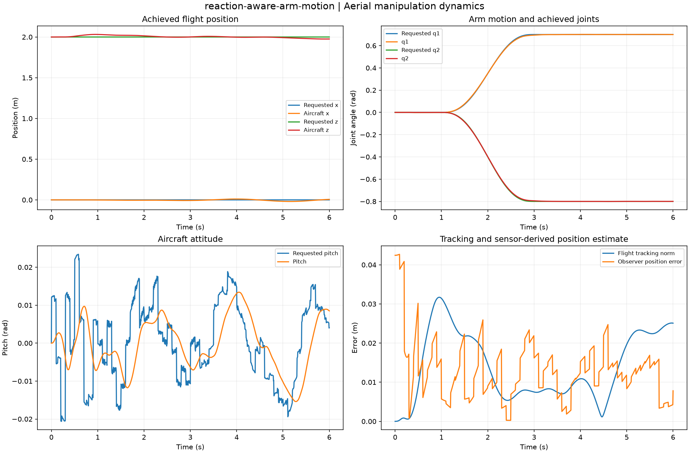

# Aerial Manipulation Lab

[](https://github.com/VictorOdoyo/aerial-manipulation-lab/actions/workflows/ci.yml)

A numerical electrical engineering and robotics laboratory for aircraft-arm coupling, sensor-derived control, rotor limits, payload interaction and flight energy.



## Run

```sh
uv sync --locked --extra dev
uv run aeriallab list
uv run aeriallab run --case reaction-aware-arm-motion --output outputs/arm
uv run aeriallab run --case complete-actuator-loss --output outputs/failure
uv run aeriallab verify outputs/arm
```

Python 3.11 or newer is supported. Built wheels expose the same `aeriallab` CLI outside the source checkout.

## What is modeled

- A coupled planar five-DoF aircraft and two-link arm, with mass-matrix cross terms, Coriolis, gravity, rigid payload and mechanical-work audits.
- Underactuated acceleration projection, noisy measured-rotor-wrench reaction compensation, bounded allocation, rotor lag, joint torque/slew limits and electrical draw.
- Causal IMU, attitude-reference, position, encoder and tachometer simulation, gyro-bias and navigation estimation, unavailable observations and innovation gating.
- Momentum-consistent pickup/release, unilateral contact and joint-stop impulses, arm kinematics, manipulability and explicit kinematic task sharing.
- Separate full spatial quaternion quadrotor benches for rigid-body invariants, attitude control and failed-rotor allocation.

The main aircraft-arm model is planar. Full spatial arm coupling is outside this release. All physical and sensor coefficients are illustrative; no hardware flight qualification is claimed.

## Evidence and methods

The [computed gallery](docs/results.md) contains all 27 studies with arrays, CSV/JSON, source provenance, plots, HTML and SHA-256 manifests. It retains unknown-payload errors, ignored-reaction drift and actuator-loss terminations.

| Method | Read |
|---|---|
| Coupled kinetic and potential energy | [Dynamics](docs/coupled-dynamics.md) |
| Feasible acceleration and rotor-state compensation | [Control](docs/control.md) |
| Causal noisy sensor feedback | [Estimation](docs/estimation.md) |
| Rotor groups, pack and electrical draw | [Actuation and power](docs/actuators-and-power.md) |
| Pickup, release and impact accounting | [Contact and payload](docs/contact-and-payload.md) |
| Full spatial benchmarks and their scope | [Spatial benches](docs/spatial-benches.md) |
| Source freezing, configs and replay | [Reproducibility](docs/reproducibility.md) |
| Independent checks and limitations | [Validation](docs/validation.md) |
| All flight and mechanics cases | [Experiments](docs/experiments.md) |
| Module map and MIT attribution | [Architecture](docs/architecture.md) |

## Custom missions

```sh
uv run aeriallab flight-replay --config examples/custom-flight.json --output outputs/custom
uv run aeriallab verify outputs/custom
uv run python examples/mechanics.py
```

Custom JSON rejects unknown options and fingerprints the original input. Default control uses sensor-derived state. The ideal-state case is explicitly labeled a benchmark.

## Reproduce and develop

```sh
uv run aeriallab batch --data-only --output outputs/catalog
uv run aeriallab render outputs/catalog
uv run aeriallab verify outputs/catalog
uv run python examples/build_gallery.py outputs/catalog --destination docs/gallery
uv run pytest -q
uv run ruff check src tests examples
uv run ruff format --check src tests examples
uv build
```

Publication requires a complete default catalog from one clean committed source. CI checks Linux/Windows, Python 3.11/3.13, formatting, published evidence and an installed-wheel report. See [contributing](CONTRIBUTING.md) and [release notes](CHANGELOG.md). MIT licensed.
