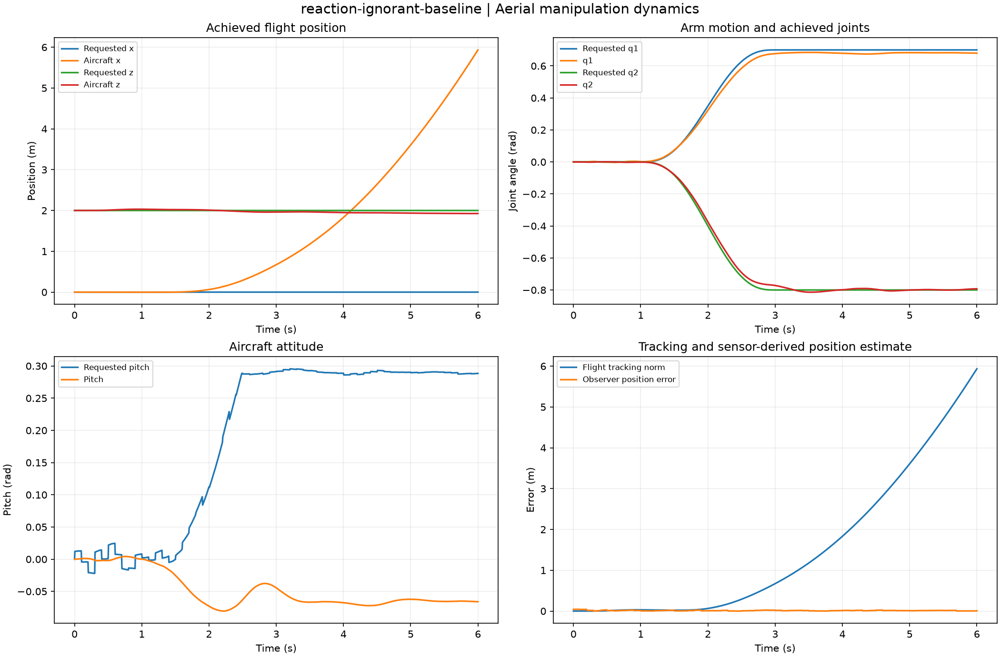
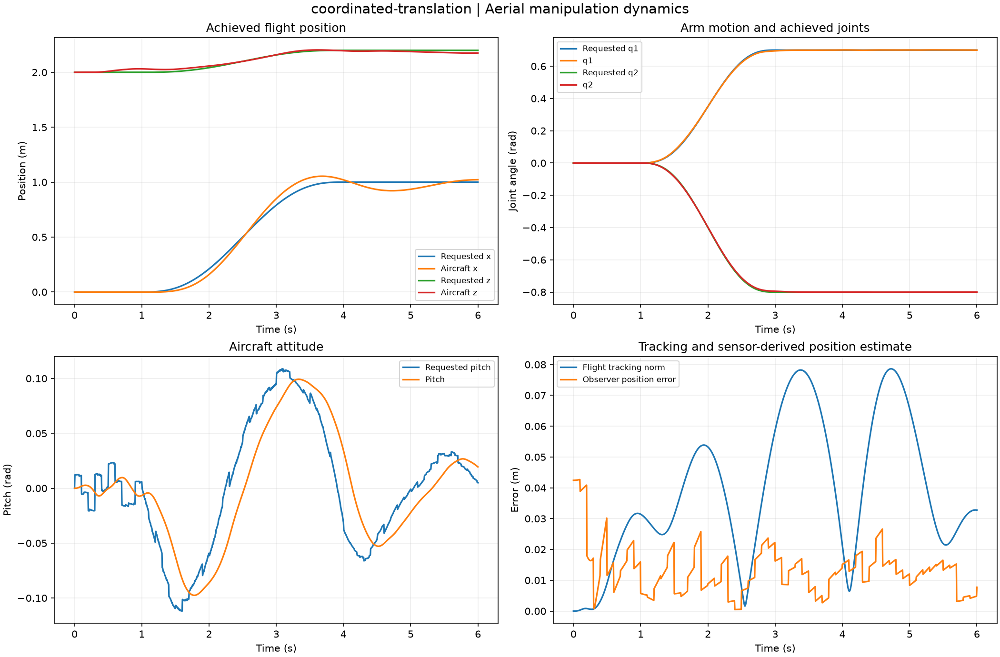
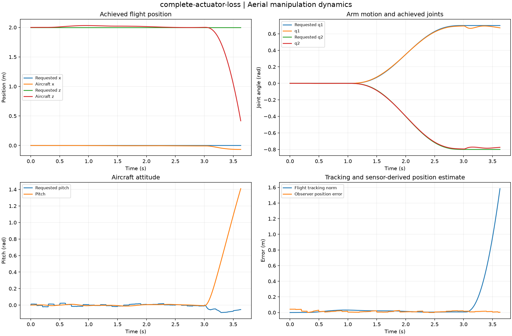
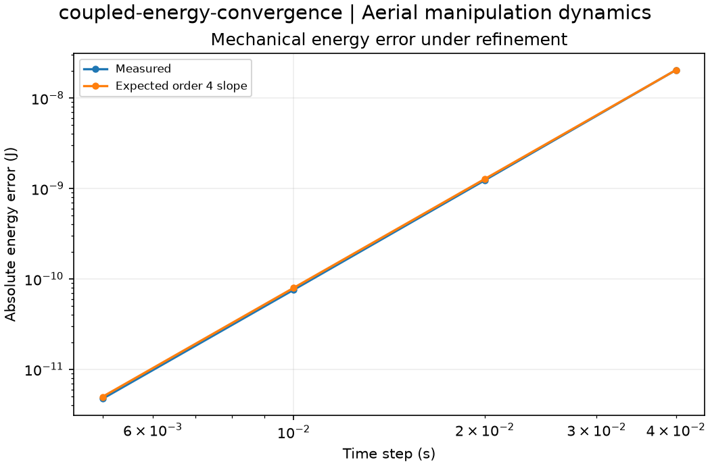

# Computed experiment gallery

42 default studies computed from clean source revision [`c7dc818cb736`](https://github.com/VictorOdoyo/aerial-manipulation-lab/commit/c7dc818cb7366218625417c06195e9af6e3b22d7).
All values below come from the sealed captures. Each case directory contains the complete
NPZ arrays, CSV tables, parameters, provenance, plot and HTML report.

HTML files can be opened locally; GitHub previews the figures and tables directly.

| Study | Selected measured outputs | Artifacts |
| --- | --- | --- |
| [reaction-aware-arm-motion](gallery/reaction-aware-arm-motion/figure.png) | termination = completed; position_rmse_m = 0.0116516; final_arm_error_rad = 0.000540643 | [summary](gallery/reaction-aware-arm-motion/summary.csv), [setup](gallery/reaction-aware-arm-motion/parameters.json), [archive](gallery/reaction-aware-arm-motion/fields.npz), [report](gallery/reaction-aware-arm-motion/index.html) |
| [sensor-feedback-hover](gallery/sensor-feedback-hover/figure.png) | termination = completed; position_rmse_m = 0.0129976; final_arm_error_rad = 0.000158216 | [summary](gallery/sensor-feedback-hover/summary.csv), [setup](gallery/sensor-feedback-hover/parameters.json), [archive](gallery/sensor-feedback-hover/fields.npz), [report](gallery/sensor-feedback-hover/index.html) |
| [reaction-ignorant-baseline](gallery/reaction-ignorant-baseline/figure.png) | termination = completed; position_rmse_m = 1.63118; final_arm_error_rad = 0.0214393 | [summary](gallery/reaction-ignorant-baseline/summary.csv), [setup](gallery/reaction-ignorant-baseline/parameters.json), [archive](gallery/reaction-ignorant-baseline/fields.npz), [report](gallery/reaction-ignorant-baseline/index.html) |
| [coordinated-translation](gallery/coordinated-translation/figure.png) | termination = completed; position_rmse_m = 0.0319557; final_arm_error_rad = 0.000589975 | [summary](gallery/coordinated-translation/summary.csv), [setup](gallery/coordinated-translation/parameters.json), [archive](gallery/coordinated-translation/fields.npz), [report](gallery/coordinated-translation/index.html) |
| [wind-gust-rejection](gallery/wind-gust-rejection/figure.png) | termination = completed; position_rmse_m = 0.0460008; final_arm_error_rad = 0.000559284 | [summary](gallery/wind-gust-rejection/summary.csv), [setup](gallery/wind-gust-rejection/parameters.json), [archive](gallery/wind-gust-rejection/fields.npz), [report](gallery/wind-gust-rejection/index.html) |
| [position-sensor-outage](gallery/position-sensor-outage/figure.png) | termination = completed; position_rmse_m = 0.0388439; final_arm_error_rad = 0.000649892 | [summary](gallery/position-sensor-outage/summary.csv), [setup](gallery/position-sensor-outage/parameters.json), [archive](gallery/position-sensor-outage/fields.npz), [report](gallery/position-sensor-outage/index.html) |
| [position-outlier-gating](gallery/position-outlier-gating/figure.png) | termination = completed; position_rmse_m = 0.0126513; final_arm_error_rad = 0.000524841 | [summary](gallery/position-outlier-gating/summary.csv), [setup](gallery/position-outlier-gating/parameters.json), [archive](gallery/position-outlier-gating/fields.npz), [report](gallery/position-outlier-gating/index.html) |
| [payload-model-mismatch](gallery/payload-model-mismatch/figure.png) | termination = completed; position_rmse_m = 0.187928; final_arm_error_rad = 0.565293 | [summary](gallery/payload-model-mismatch/summary.csv), [setup](gallery/payload-model-mismatch/parameters.json), [archive](gallery/payload-model-mismatch/fields.npz), [report](gallery/payload-model-mismatch/index.html) |
| [known-heavy-payload](gallery/known-heavy-payload/figure.png) | termination = completed; position_rmse_m = 0.0113928; final_arm_error_rad = 0.000631051 | [summary](gallery/known-heavy-payload/summary.csv), [setup](gallery/known-heavy-payload/parameters.json), [archive](gallery/known-heavy-payload/fields.npz), [report](gallery/known-heavy-payload/index.html) |
| [partial-actuator-loss](gallery/partial-actuator-loss/figure.png) | termination = flight-envelope-exceeded; position_rmse_m = 0.26128; final_arm_error_rad = 0.0612133 | [summary](gallery/partial-actuator-loss/summary.csv), [setup](gallery/partial-actuator-loss/parameters.json), [archive](gallery/partial-actuator-loss/fields.npz), [report](gallery/partial-actuator-loss/index.html) |
| [complete-actuator-loss](gallery/complete-actuator-loss/figure.png) | termination = flight-envelope-exceeded; position_rmse_m = 0.202991; final_arm_error_rad = 0.037724 | [summary](gallery/complete-actuator-loss/summary.csv), [setup](gallery/complete-actuator-loss/parameters.json), [archive](gallery/complete-actuator-loss/fields.npz), [report](gallery/complete-actuator-loss/index.html) |
| [low-pack-headroom](gallery/low-pack-headroom/figure.png) | termination = completed; position_rmse_m = 0.0116516; final_arm_error_rad = 0.000540643 | [summary](gallery/low-pack-headroom/summary.csv), [setup](gallery/low-pack-headroom/parameters.json), [archive](gallery/low-pack-headroom/fields.npz), [report](gallery/low-pack-headroom/index.html) |
| [ideal-state-feedback-benchmark](gallery/ideal-state-feedback-benchmark/figure.png) | termination = completed; position_rmse_m = 0.00388235; final_arm_error_rad = 0.000419945 | [summary](gallery/ideal-state-feedback-benchmark/summary.csv), [setup](gallery/ideal-state-feedback-benchmark/parameters.json), [archive](gallery/ideal-state-feedback-benchmark/fields.npz), [report](gallery/ideal-state-feedback-benchmark/index.html) |
| [coupled-energy-convergence](gallery/coupled-energy-convergence/figure.png) | coarse_error_j = 2.03707e-08; fine_error_j = 4.72511e-12 | [summary](gallery/coupled-energy-convergence/summary.csv), [setup](gallery/coupled-energy-convergence/parameters.json), [archive](gallery/coupled-energy-convergence/fields.npz), [report](gallery/coupled-energy-convergence/index.html) |
| [internal-reaction-momentum](gallery/internal-reaction-momentum/figure.png) | final_pitch_rad = -0.178571; maximum_momentum_defect_n_s = 3.4528e-11 | [summary](gallery/internal-reaction-momentum/summary.csv), [setup](gallery/internal-reaction-momentum/parameters.json), [archive](gallery/internal-reaction-momentum/fields.npz), [report](gallery/internal-reaction-momentum/index.html) |
| [hover-trim-workspace](gallery/hover-trim-workspace/figure.png) | heavy_feasible_fraction = 0.821782; nominal_feasible_fraction = 1 | [summary](gallery/hover-trim-workspace/summary.csv), [setup](gallery/hover-trim-workspace/parameters.json), [archive](gallery/hover-trim-workspace/fields.npz), [report](gallery/hover-trim-workspace/index.html) |
| [rotor-lag-response](gallery/rotor-lag-response/figure.png) | final_force_n = 23.9973; final_torque_nm = 0.996715 | [summary](gallery/rotor-lag-response/summary.csv), [setup](gallery/rotor-lag-response/parameters.json), [archive](gallery/rotor-lag-response/fields.npz), [report](gallery/rotor-lag-response/index.html) |
| [payload-capture-release](gallery/payload-capture-release/figure.png) | maximum_energy_defect_j = 1.11022e-15; maximum_momentum_defect_n_s = 8.9509e-16 | [summary](gallery/payload-capture-release/summary.csv), [setup](gallery/payload-capture-release/parameters.json), [archive](gallery/payload-capture-release/fields.npz), [report](gallery/payload-capture-release/index.html) |
| [contact-impact-restitution](gallery/contact-impact-restitution/figure.png) | elastic_energy_loss_j = 4.44089e-15; maximum_velocity_residual_m_s = 8.88178e-16 | [summary](gallery/contact-impact-restitution/summary.csv), [setup](gallery/contact-impact-restitution/parameters.json), [archive](gallery/contact-impact-restitution/fields.npz), [report](gallery/contact-impact-restitution/index.html) |
| [arm-manipulability](gallery/arm-manipulability/figure.png) | maximum_area_residual_m2 = 5.55112e-17 | [summary](gallery/arm-manipulability/summary.csv), [setup](gallery/arm-manipulability/parameters.json), [archive](gallery/arm-manipulability/fields.npz), [report](gallery/arm-manipulability/index.html) |
| [joint-stop-base-reaction](gallery/joint-stop-base-reaction/figure.png) | maximum_base_pitch_rate_rad_s = 0.683318; maximum_momentum_defect_n_s = 6.20634e-17 | [summary](gallery/joint-stop-base-reaction/summary.csv), [setup](gallery/joint-stop-base-reaction/parameters.json), [archive](gallery/joint-stop-base-reaction/fields.npz), [report](gallery/joint-stop-base-reaction/index.html) |
| [kinematic-task-sharing](gallery/kinematic-task-sharing/figure.png) | maximum_task_residual_m_s = 7.07631e-17 | [summary](gallery/kinematic-task-sharing/summary.csv), [setup](gallery/kinematic-task-sharing/parameters.json), [archive](gallery/kinematic-task-sharing/fields.npz), [report](gallery/kinematic-task-sharing/index.html) |
| [spatial-free-rotation](gallery/spatial-free-rotation/figure.png) | maximum_energy_defect_j = 1.12838e-12; maximum_momentum_defect = 3.21998e-11 | [summary](gallery/spatial-free-rotation/summary.csv), [setup](gallery/spatial-free-rotation/parameters.json), [archive](gallery/spatial-free-rotation/fields.npz), [report](gallery/spatial-free-rotation/index.html) |
| [spatial-attitude-recovery](gallery/spatial-attitude-recovery/figure.png) | final_attitude_error_rad = 8.49066e-07; maximum_force_residual_n = 1.42109e-14 | [summary](gallery/spatial-attitude-recovery/summary.csv), [setup](gallery/spatial-attitude-recovery/parameters.json), [archive](gallery/spatial-attitude-recovery/fields.npz), [report](gallery/spatial-attitude-recovery/index.html) |
| [quadrotor-failure-allocation](gallery/quadrotor-failure-allocation/figure.png) | maximum_failed_moment_error_nm = 0.599049 | [summary](gallery/quadrotor-failure-allocation/summary.csv), [setup](gallery/quadrotor-failure-allocation/parameters.json), [archive](gallery/quadrotor-failure-allocation/fields.npz), [report](gallery/quadrotor-failure-allocation/index.html) |
| [inertial-position-outage](gallery/inertial-position-outage/figure.png) | final_position_error_m = 0.0194373; maximum_position_error_m = 0.121986 | [summary](gallery/inertial-position-outage/summary.csv), [setup](gallery/inertial-position-outage/parameters.json), [archive](gallery/inertial-position-outage/fields.npz), [report](gallery/inertial-position-outage/index.html) |
| [navigation-observability](gallery/navigation-observability/figure.png) | three_measurement_rank = 6; two_measurement_rank = 4 | [summary](gallery/navigation-observability/summary.csv), [setup](gallery/navigation-observability/parameters.json), [archive](gallery/navigation-observability/fields.npz), [report](gallery/navigation-observability/index.html) |
| [task-inertia-payload](gallery/task-inertia-payload/figure.png) | loaded_effective_mass_kg = 1.05662; minimum_effective_mass_kg = 0.0566199 | [summary](gallery/task-inertia-payload/summary.csv), [setup](gallery/task-inertia-payload/parameters.json), [archive](gallery/task-inertia-payload/fields.npz), [report](gallery/task-inertia-payload/index.html) |
| [dynamic-task-velocity](gallery/dynamic-task-velocity/figure.png) | maximum_energy_saving_j = 0.0365175 | [summary](gallery/dynamic-task-velocity/summary.csv), [setup](gallery/dynamic-task-velocity/parameters.json), [archive](gallery/dynamic-task-velocity/fields.npz), [report](gallery/dynamic-task-velocity/index.html) |
| [nullspace-joint-barrier](gallery/nullspace-joint-barrier/figure.png) | maximum_tip_leak_m_s = 1.8212e-14; minimum_barrier_descent = 12.9457 | [summary](gallery/nullspace-joint-barrier/summary.csv), [setup](gallery/nullspace-joint-barrier/parameters.json), [archive](gallery/nullspace-joint-barrier/fields.npz), [report](gallery/nullspace-joint-barrier/index.html) |
| [bilateral-contact-reaction](gallery/bilateral-contact-reaction/figure.png) | max_constraint_residual_m_s2 = 6.54308e-15 | [summary](gallery/bilateral-contact-reaction/summary.csv), [setup](gallery/bilateral-contact-reaction/parameters.json), [archive](gallery/bilateral-contact-reaction/fields.npz), [report](gallery/bilateral-contact-reaction/index.html) |
| [impedance-virtual-work](gallery/impedance-virtual-work/figure.png) | max_power_defect_w = 5.32907e-15 | [summary](gallery/impedance-virtual-work/summary.csv), [setup](gallery/impedance-virtual-work/parameters.json), [archive](gallery/impedance-virtual-work/fields.npz), [report](gallery/impedance-virtual-work/index.html) |
| [task-force-authority](gallery/task-force-authority/figure.png) | minimum_scale = 0.0818582 | [summary](gallery/task-force-authority/summary.csv), [setup](gallery/task-force-authority/parameters.json), [archive](gallery/task-force-authority/fields.npz), [report](gallery/task-force-authority/index.html) |
| [bounded-quintic-motion](gallery/bounded-quintic-motion/figure.png) | duration_s = 2.25; max_velocity_rad_s = 1 | [summary](gallery/bounded-quintic-motion/summary.csv), [setup](gallery/bounded-quintic-motion/parameters.json), [archive](gallery/bounded-quintic-motion/fields.npz), [report](gallery/bounded-quintic-motion/index.html) |
| [rest-to-rest-waypoints](gallery/rest-to-rest-waypoints/figure.png) | final_joint1_rad = -0.2 | [summary](gallery/rest-to-rest-waypoints/summary.csv), [setup](gallery/rest-to-rest-waypoints/parameters.json), [archive](gallery/rest-to-rest-waypoints/fields.npz), [report](gallery/rest-to-rest-waypoints/index.html) |
| [continuous-path-clearance](gallery/continuous-path-clearance/figure.png) | detour_clearance_m = 0.25; direct_collision = True | [summary](gallery/continuous-path-clearance/summary.csv), [setup](gallery/continuous-path-clearance/parameters.json), [archive](gallery/continuous-path-clearance/fields.npz), [report](gallery/continuous-path-clearance/index.html) |
| [quintic-jerk-tradeoff](gallery/quintic-jerk-tradeoff/figure.png) | max_relative_quadrature_error = 9.99999e-06 | [summary](gallery/quintic-jerk-tradeoff/summary.csv), [setup](gallery/quintic-jerk-tradeoff/parameters.json), [archive](gallery/quintic-jerk-tradeoff/fields.npz), [report](gallery/quintic-jerk-tradeoff/index.html) |
| [payload-mass-identification](gallery/payload-mass-identification/figure.png) | declared_std_kg = 0.000411139; estimated_payload_kg = 0.349621 | [summary](gallery/payload-mass-identification/summary.csv), [setup](gallery/payload-mass-identification/parameters.json), [archive](gallery/payload-mass-identification/fields.npz), [report](gallery/payload-mass-identification/index.html) |
| [viscous-damping-identification](gallery/viscous-damping-identification/figure.png) | maximum_coefficient_error = 0.000253785 | [summary](gallery/viscous-damping-identification/summary.csv), [setup](gallery/viscous-damping-identification/parameters.json), [archive](gallery/viscous-damping-identification/fields.npz), [report](gallery/viscous-damping-identification/index.html) |
| [contact-wrench-conditioning](gallery/contact-wrench-conditioning/figure.png) | unobservable_samples = 1 | [summary](gallery/contact-wrench-conditioning/summary.csv), [setup](gallery/contact-wrench-conditioning/parameters.json), [archive](gallery/contact-wrench-conditioning/fields.npz), [report](gallery/contact-wrench-conditioning/index.html) |
| [unilateral-force-projection](gallery/unilateral-force-projection/figure.png) | max_cone_violation_n = 0 | [summary](gallery/unilateral-force-projection/summary.csv), [setup](gallery/unilateral-force-projection/parameters.json), [archive](gallery/unilateral-force-projection/fields.npz), [report](gallery/unilateral-force-projection/index.html) |
| [coupled-friction-impact](gallery/coupled-friction-impact/figure.png) | max_post_normal_speed_m_s = 2.82672e-16; minimum_dissipation_j = 0.287152 | [summary](gallery/coupled-friction-impact/summary.csv), [setup](gallery/coupled-friction-impact/parameters.json), [archive](gallery/coupled-friction-impact/fields.npz), [report](gallery/coupled-friction-impact/index.html) |

## Selected fields and diagnostics

### reaction-aware-arm-motion

### reaction-ignorant-baseline

### coordinated-translation

### complete-actuator-loss

### coupled-energy-convergence

## Interpretation

Main flight couples a planar aircraft and two-link arm with sensor-derived feedback. Separate quaternion benches cover full spatial rigid-body flight. Unmodeled payload and actuator loss retain their actual errors and envelope terminations. Small conservation residuals verify the numerical model, not hardware accuracy.

Reproduce with `aeriallab batch --data-only --output outputs/catalog`, then `aeriallab render outputs/catalog` and `aeriallab verify outputs/catalog`. Replay retains the original solve source revision.
